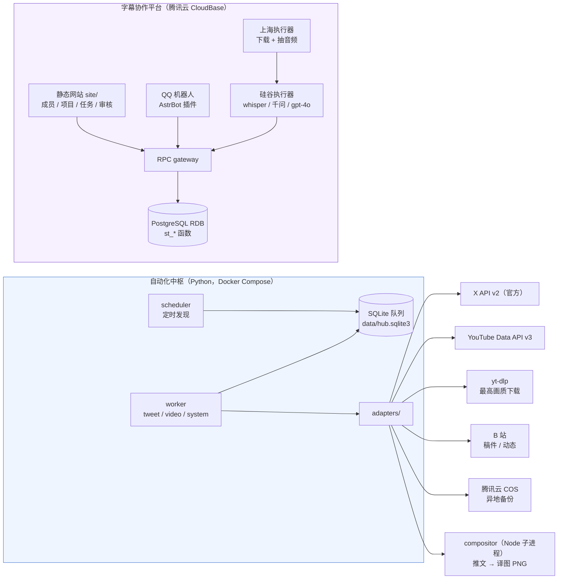

# 咕噜咕噜灯塔字幕组 · 开源工具箱

**两种公开预算：** 双机标准版是一台上海（境内）2 核 4G、60 GB 系统盘 + 一台硅谷（境外，推荐美国或日本地域）2 核 4G、90 GB 系统盘 + 腾讯云开发 CloudBase 标准版，适合小团队先把两套工具跑通；减配版是单台海外服务器 + 家用电脑冷备份 + 千问 ASR/本地 Whisper，适合预算优先、能自己承担运维的场景。回放素材体积大，系统盘只放系统和代码，媒体请使用数据盘或 COS。

**统一计时口径：两版均按全组每月合计 2 小时音频估算**，即 120 分钟 / 7,200 秒，不是每天 2 小时，也不按主播人数重复乘算。X API 仍按 2 位主播。以下模型预算不扣赠送额度，美元沿用 ¥7.2/$ 的预算汇率。

### 双机标准版（CloudBase）

| 项目 | 参考规格/口径 | 约月费 |
| --- | --- | ---: |
| 上海服务器（轻量应用服务器） | 2 核 4G / 60 GB SSD / 5 Mbps / 500 GB 流量 | ¥65 |
| 海外服务器（轻量应用服务器） | 2 核 4G / 90 GB SSD / 30 Mbps / 2.5 TB 流量（硅谷、美国或日本） | ¥88 |
| 腾讯云开发 CloudBase 标准版 | 330,000 资源点/月 | ¥199 |
| X API | 每位主播 $2/月（按 2 位主播约 $4） | 约 ¥29 |
| 运维与功能定制 | 每月 | ¥30 |
| **基础小计（按 2 位主播，不含下列模型费用）** | 服务器 + CloudBase + X API + 运维 | **约 ¥411/月（约 ¥4,932/年）** |
| whisper-1 | 全文 120 分钟 × $0.006/分钟 × ¥7.2/$ | 约 ¥5.18 |
| 千问 ASR | 全文 7,200 秒 × ¥0.00022/秒（北京） | 约 ¥1.58 |
| gpt-transcribe（规划） | 约 20% 音频复核：120 分钟 × 20% × $0.0045/分钟 × ¥7.2/$ | 约 ¥0.78 |
| **标准版总计** | ¥411 + ¥5.184 + ¥1.584 + ¥0.7776 | **约 ¥418.55/月** |

以上基础设施按腾讯云公开刊例价估算（上海入门型、海外通用型、CloudBase 标准版）；X API 与运维按生产环境实测口径，美元按 **¥7.2/$** 估算，X API 按 2 位主播计。**标准版保留 whisper-1 与千问 ASR 的全文识别，原 4o 项改为 gpt-transcribe 约 20% 音频复核规划**，不采用减配版的模型替代方案。这里按实际送入复核的音频占 20% 估算，额外上下文音频和重试须按实际分钟另计；不再套用文本 GPT-4o 的 token 单价。上述基础小计按公开价估算，通过渠道商或活动折扣价可能降低支出，但它不是包含模型调用的总预算上限；每增减一位主播，X API 约增减 ¥14/月。不含 COS 备份、超额流量、域名、短信等，按需另计。上海若选锐驰型（200 Mbps、无限流量）约 ¥72/月，不含模型费用的基础小计约 ¥418/月；海外 Linux 或活动价以下单页为准。价格参考：[轻量应用服务器价格总览](https://cloud.tencent.com/document/product/1207/73452)、[CloudBase 定价](https://tcb.cloud.tencent.com/pricing)。

gpt-transcribe 是官方推荐的高精度文件语音转写模型，本预算用于约 24 分钟音频的重新转写复核，不是文本 GPT-4o 校对。只修订文档中的模型选型与预算，**尚未改动运行代码或完成新模型接入**。表格分项显示两位小数，合计按未四舍五入值计算；不含另行启用的文本翻译/校对服务。

**字幕时间轴方案待实测后确定。** 不将新模型视为原生输出词级时间戳或 SRT 的替代品；现有 whisper-1 的时间戳/字幕接口不能只换模型名就当作兼容。保留 whisper-1 全文预算不代表长期迁移方案：官方指南说明其现有时间戳能力可用至 **2027-02-26**，后续替代与对齐方案由实际测试决定。

费率与能力来源：[Whisper 模型价格](https://developers.openai.com/api/docs/models/whisper-1)、[gpt-transcribe 模型价格](https://developers.openai.com/api/docs/models/gpt-transcribe)、[文件转写与时间戳说明](https://developers.openai.com/api/docs/guides/speech-to-text)、[千问 filetrans 模型价格](https://help.aliyun.com/zh/model-studio/qwen3-asr-flash-filetrans)。核对日期：2026-11-08。

### 减配版（单机 + 家用冷备 + 千问 ASR/本地 Whisper）

**这是预算与部署规划，不是现成的一键部署版。** 现有协作平台仍依赖 CloudBase 的身份认证、RPC 与存储，需要完成适配和验收后才能替换。详见 [减配版部署与安全说明](docs/lite-deployment.md)。

| 项目 | 参考规格/口径 | 约月费 |
| --- | --- | ---: |
| 海外单机（轻量应用服务器） | 2 核 4G / 90 GB SSD / 30 Mbps / 2.5 TB 流量（硅谷、美国或日本） | ¥88 |
| 家用电脑冷备份 | 每周 `pg_dump` + 媒体增量，外置硬盘一次性成本 | ¥0/月 |
| 千问 ASR | `qwen3-asr-flash-filetrans`，每月 2 小时 × 3,600 秒 × ¥0.00022/秒；不扣赠送额度 | 约 ¥1.58 |
| 本地 Whisper | 兜底/离线/隐私，API ¥0；CPU 跑长音频较慢 | ¥0 |
| X API | 每位主播 $2/月（按 2 位主播约 $4） | 约 ¥29 |
| 运维与功能定制 | 每月 | ¥30 |
| **合计（按 2 位主播）** | 单机 + 每月 2 小时千问 ASR | **约 ¥148.58/月（约 ¥1,783.01/年）** |

如果全部走本地 Whisper、不用千问 ASR，约 **¥147/月**；如果把单机升到 4 核 8G 以并行跑 Whisper，服务器约 ¥160–200/月，按每月 2 小时千问 ASR 合计约 **¥220.58–260.58/月**。

减配方案的翻译计划改用千问/本地模型，预算里不计 OpenAI 固定 API 费；这不代表现有代码依赖已移除，如产生模型调用费用，按量另计。

减配版计划把上海服务器、海外服务器和 CloudBase 标准版合并为一台海外服务器：静态网站、PostgreSQL、QQ 机器人和 worker 都放在同一台机器上，视频也保存在本机数据盘。省掉了 CloudBase 标准版 ¥199/月，但也不再享有云托管的 SLA、自动备份和数据回档，需要自己负责防火墙、TLS、数据库升级、磁盘和故障恢复。

两版现均按每月 2 小时音频估算；标准版预算包含两路全文 ASR 与约 20% gpt-transcribe 音频复核规划，减配版只计千问 ASR，功能与质量取舍不同，实际节省以真实账单为准。家用冷备和本地 Whisper 的 ¥0 只表示不计新增服务/API 费，不包含电费、硬件和人工。千问免费额度是否可每月持续使用、有效期与用量上限须自行确认，不能将一次性赠送额度当作长期月度优惠。

几个必须接受的取舍：

- **单点故障**：机器挂了网站、机器人和任务队列一起停；家用冷备只能恢复，不能实时接管。
- **冷备 RPO**：备份间隔内产生的数据会丢失；至少每周做一次 `pg_dump`，并实际演练一次恢复。
- **本地 Whisper**：2 核 CPU 跑长回放会很慢，建议长音频优先走千问 ASR，Whisper 只做兜底/隐私场景；要稳定并行再考虑 GPU，成本另计。
- **媒体盘**：90 GB 系统盘不够放多条长回放，需挂数据盘并设置清理策略。
- **QQ 连通性**：单机在海外，QQ 官方 API 的延迟和稳定性需要先实测；如有问题，机器人仍需放回境内。
- **价格口径**：千问按华北2（北京）0.00022 元/秒估算，新加坡地域为 0.00026 元/秒；免费额度和活动价以百炼控制台为准。美元仍按 **¥7.2/$**，基础设施沿用公开刊例价预算，不含域名、超额流量、对象存储和家用硬盘一次性成本。

本项目由 **GPT-6Astra** 与 **DeepseekV4.1flash** 搭建；基础设施按公开价目列示，X API/运维沿用既有估算口径，模型费用按各版说明另行核算。预算不是实际账单或费用上限。

这是字幕组日常在用的两套工具，放在同一个仓库里：

- **自动化中枢**（Python / Docker Compose）：把一条 **YouTube 长直播回放** 或一条 **X 推文**，自动变成 B 站上的稿件或动态。
- **字幕协作平台**（静态网站 + CloudBase PostgreSQL + QQ 机器人 + 自托管字幕执行器）：把 **人** 组织起来——谁申请入组、谁认领任务、谁交付、谁审核、积分怎么记。

两套工具数据独立、可以分别部署；同一个仓库只是为了让第一次来的人一次看全。默认全部离线或 `DRY_RUN`，不调用真实平台、不产生费用，也不含任何真实账号、Cookie、生产库和投稿素材。

## 四个模块

| 模块 | 它解决什么问题 | 源码 | 详细指南 |
| --- | --- | --- | --- |
| ① 字幕组网站与 OA 协作平台 | 让"一项字幕任务"从申请、建项目、发布任务、认领、交付到审核、积分都有记录，不再靠群聊口头同步 | `subtitle-platform/site/`（前端）、`subtitle-platform/database/`（PostgreSQL 迁移与函数）、`subtitle-platform/tools/`（部署配置） | [docs/website-oa.md](docs/website-oa.md) |
| ② QQ 群聊机器人 | 组员在 QQ 里查自己的任务、待领任务、项目列表；组长在群里收到新申请与执行结果通知 | `subtitle-platform/bot/plugins/`（AstrBot 插件：`subtitle_bridge`、`subtitle_notify`） | [docs/qq-bot.md](docs/qq-bot.md) |
| ③ YouTube 直播回放自动投稿 | 长回放被发现、排队、按最高画质下载、校验完整性、做封面、按需分段、投稿 B 站，并把 BV 号写回、清理素材 | `services/hub/youtube_*.py`、`services/hub/replay_*.py`、`services/hub/replay_fifo_v4.py`、`adapters/ytdlp_*.py` | [docs/youtube-replay.md](docs/youtube-replay.md) |
| ④ X 推文自动翻译与 B 站动态 | 官方 API 发现新帖、去重、翻译、独立质检、排版成 PNG、发布 B 站动态并回写链接 | `services/hub/x_api_discovery.py`、`services/hub/machine_tweets*.py`、`adapters/compositor.py`、`compositor/`（submodule） | [docs/tweet-translation.md](docs/tweet-translation.md) |

## 架构：真实连接关系



要点（都有代码依据）：

- **中枢与平台不共享数据库**：中枢用 SQLite（`services/hub/db.py` 建 `jobs` / `heartbeats` / `audit`），平台用 CloudBase PostgreSQL（`subtitle-platform/database/migrations/`）。两边唯一的关联是同一条内容在各自系统里都有记录，靠来源链接人工对齐。
- **QQ 机器人不直连数据库**：它只调用 gateway 的 `st_qq_dispatch` / `st_qq_notification_feed`（`subtitle-platform/bot/plugins/astrbot_plugin_subtitle_bridge/bridge.py`、`.../subtitle_notify/main.py`），权限与数据边界都在 SQL 函数里。
- **字幕执行器拆成上海 + 硅谷**：上海从 CloudBase 同地域下载原视频并只抽音频，硅谷用 whisper-1 / 千问 / gpt-4o 做识别、翻译和发布；两端都只走 RPC（`st_cloud_worker_call`、`st_subtitle_auto_decide` 等，见 `subtitle-platform/docs/AUTOMATION.md`）。
- **白名单自动审批**：组长网页配置成员与每日限额，执行器每 5 分钟自动批准并领取；不在白名单的申请仍由组长手动批准。
- **译图是中枢的子进程**：`adapters/compositor.py` 调 `node adapters/render_bridge.mjs`（即 `compositor/` 子模块），只负责"文本 → PNG"，B 站发布由 `services/hub/publishing.py` 与 `adapters/bilibili.py` 负责。
- **生产与公开版的区别**：公开版默认 `DRY_RUN=true`、所有采集/下载/发布开关为 `false`；生产环境验证过的流程在 `docs/` 各指南里单独标注。

## 四个快速入口

```bash
# ① 网站与 OA：离线跑数据库/前端测试（不需要任何云账号）
cd subtitle-platform
npm ci
npm test
python tools/check_release.py

# ② QQ 机器人：生成绑定配置（只写本地文件，不连网）
python subtitle-platform/tools/configure_bot.py --deployment <你的部署目录>

# ③ YouTube 回放：启动中枢并初始化队列（DRY_RUN，不下载）
cp config/hub.example.toml config/hub.toml
cp .env.example .env
docker compose build
docker compose run --rm api python -m services.hub.cli init
docker compose run --rm api python -m services.hub.cli status

# ④ X 推文：离线跑翻译/排版相关测试
docker compose run --rm api python -m pytest tests/test_tweet.py tests/test_manual_openai.py -q
```

## 仓库结构

```
README.md                 本页：四模块导航、架构、快速入口
docs/                     四份模块指南 + 架构依据 + 运维手册
services/ adapters/      自动化中枢：队列、采集、回放、投稿、备份
scheduler/               持久化调度器与 SQL 迁移
config/                  中枢示例配置（hub.example.toml、策略示例）
tests/                   中枢离线测试（合成数据）
subtitle-platform/       字幕协作平台
  site/ database/ worker/ bot/ ops/ tools/ tests/ docs/
compositor/              tweet-zh-compositor（git submodule）
vendor/subtitle-cloud-worker/  云端字幕 worker（git submodule）
```

## 哪些在仓库里、哪些是外部依赖、哪些只是历史原型

| 内容 | 状态 |
| --- | --- |
| 自动化中枢（Python） | 在本仓库，可独立运行 |
| 协作平台（网站 + 数据库 + 云端 worker 接口） | 在本仓库 `subtitle-platform/`，需要自己的 CloudBase 环境 |
| QQ 机器人插件 | 在本仓库 `subtitle-platform/bot/`，需要 AstrBot 与 QQ 官方机器人 |
| `tweet-zh-compositor` | **外部 submodule**（`compositor/`），`git clone --recursive` 获取 |
| `subtitle-cloud-worker` | **外部 submodule**（`vendor/subtitle-cloud-worker/`），运行在 Codex Cloud |
| 平台历史实验（初版工作器、未启用调度器） | `subtitle-platform/experiments/`，仅作研究保留，不参与默认流程 |
| 真实账号、Cookie、生产库、备份、媒体 | **不在仓库**；样例均为合成数据 |

## 许可证与署名

本仓库自有代码以 **GNU AGPL-3.0** 发布（根 `LICENSE`）；`subtitle-platform/` 原本即 AGPL-3.0，保留其 `LICENSE`、`THIRD_PARTY_NOTICES.md`、`SECURITY.md` 与 `SOURCE_MANIFEST.json`。

`compositor/` 与 `vendor/subtitle-cloud-worker/` 通过 git submodule 引用各自仓库的固定提交，许可证与使用条款见对应仓库；参考 `subtitle-platform/THIRD_PARTY_NOTICES.md`。

## 继续读

- 平台怎么从零搭：[`subtitle-platform/docs/从零搭建.md`](subtitle-platform/docs/从零搭建.md)
- 平台使用手册：[`subtitle-platform/docs/使用手册.md`](subtitle-platform/docs/使用手册.md)
- 平台架构与数据：[`subtitle-platform/docs/架构与数据.md`](subtitle-platform/docs/架构与数据.md)
- 日常运维（状态、备份、日志、重启恢复）：[docs/operations.md](docs/operations.md)
