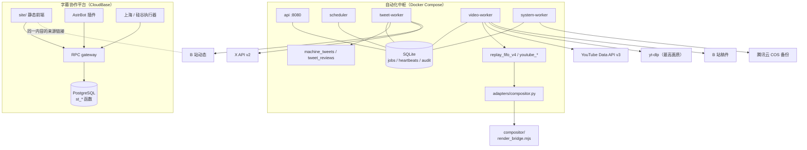

# 架构与代码依据

本页回答三个问题：两套工具各自由什么组成、它们在哪里连接、每条连接在代码里的依据是什么。首页的图是简版，这里给出完整版。

## 部署单元

| 单元 | 运行位置 | 进程 / 容器 | 数据 |
| --- | --- | --- | --- |
| 自动化中枢 | 一台 Linux 服务器（Docker Compose） | `api`、`scheduler`、`tweet-worker`、`video-worker`、`system-worker` | `./data/hub.sqlite3`（队列、审计、心跳）、`./media`、`./logs`、`./backups` |
| 字幕协作平台 | 腾讯云 CloudBase | 静态站点 + PostgreSQL RDB + RPC gateway | 平台自己的 PostgreSQL 实例 |
| QQ 机器人 | 一台常开的服务器（AstrBot） | AstrBot + 两个插件 | 本地 `subtitle_bridge.json`、`subtitle_notifications.json` |
| 字幕执行器 | 上海（下载/抽音频）+ 硅谷（识别/翻译/发布） | `subtitle-platform/runner/`、`worker/` | 通过 RPC 读写平台数据 |
| 译图排版 | 中枢所在服务器 | `compositor/`（Node 子进程） | 输出 PNG 到中枢 `media/` |

## 完整连接图

## 连接与代码依据

| 连接 | 代码依据 | 说明 |
| --- | --- | --- |
| 中枢进程 ↔ 队列 | `services/hub/db.py`（`jobs`、`heartbeats`、`audit`）、`services/hub/worker.py`（租约、attempts、retry） | 所有 worker 只通过 SQLite 队列协作 |
| 回放去重 | `services/hub/replay_fifo_v4.py`：`replay_fifo_v4` 表 `UNIQUE(source_id,target_uid)`，`_existing()` 检查已投稿/墓碑/已有素材任务 | 同一来源不会被重复登记为两个候选 |
| 回放计划/下载/投稿 | `services/hub/youtube_download_v4.py`、`services/hub/replay_parts_v5.py`、`services/hub/replay_part_publish_worker_v5.py` | 计划、下载、分段、投稿各是独立 job |
| 推文去重 | `services/hub/x_api_discovery.py`：`known` 集合来自 `jobs` + `source_tombstones` + `publications` + capture queue | 已处理或已发布的帖子不会重复创建任务 |
| 译图 | `adapters/compositor.py` 调 `node adapters/render_bridge.mjs` → `compositor/` | 只产出 PNG 与报告，不发布 |
| B 站发布 | `services/hub/publishing.py`（幂等键、`PublishUnknown`）、`adapters/bilibili.py` | 结果未知时只允许查结果，不允许重发 |
| 异地备份 | `services/hub/cloudbase_backup_runtime.py`、`adapters/cloudbase_cos_backup.py` | systemd timer 触发，写收据到 `audit` |
| 平台权限与任务流 | `subtitle-platform/database/migrations/002_closed_application_functions.sql`（`st_claim_task`、`st_submit`、`st_review`）、`016_project_claim_workflow.sql`、`045_credit_reporting.sql` | 所有业务规则在 SQL 函数里，前端不直写表 |
| QQ 指令 | `subtitle-platform/bot/plugins/astrbot_plugin_subtitle_bridge/bridge.py`（命令表、`st_qq_dispatch` 调用）、`.../subtitle_notify/main.py`（`st_qq_notification_feed`） | 机器人只发 RPC，不直连数据库 |
| API 字幕执行 | `subtitle-platform/runner/poll_shanghai.py`、`fetch_shanghai.py`、`ingest.py`，通过 `st_subtitle_auto_decide` / `st_cloud_worker_call` 等 RPC 访问平台 | 常驻服务器领取、执行并回传；不依赖 Codex Cloud。`st_cloud_*` 是仍在使用的数据库接口名，不是删除依据 |

## 边界

- **中枢与平台不共享数据库**，也没有自动同步。两边各自记录同一条内容（例如同一场直播），通过来源链接对齐；这是有意的隔离，避免任一系统故障影响另一套。
- **公开版不含生产配置**：中枢的 `config/hub.toml` 需要从 `hub.example.toml` 复制并改；平台的域名、环境 ID、key 由 `tools/configure.py` 生成到独立部署目录。
- **收费与发布默认关闭**：中枢 `DRY_RUN=true`、所有开关 `false`；平台的白名单成员由执行器自动批准并处理，非白名单仍由组长审核；执行器拆成上海拉取与硅谷识别两段。
