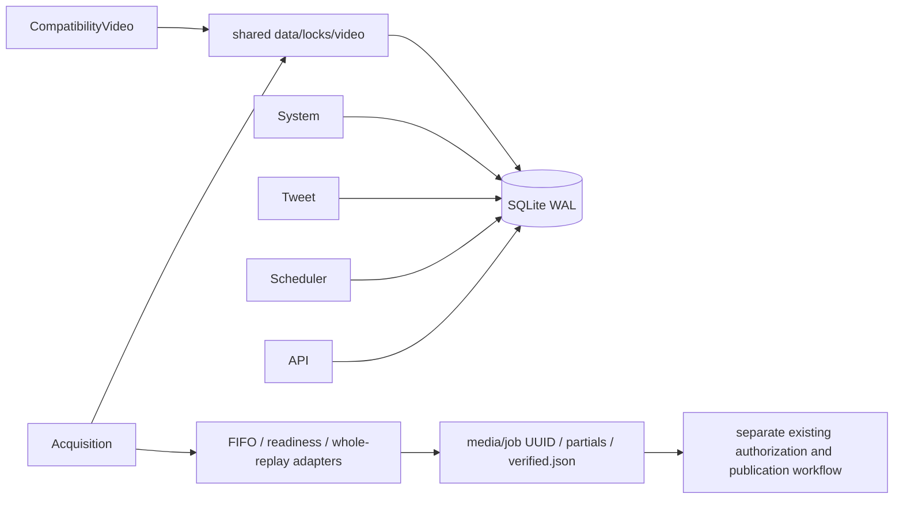

# Lighthouse Download Worker 2.0

Download Worker 2.0 isolates the existing FIFO V4 acquisition implementation in a
dedicated container. It does not change persisted job_type versions or introduce
a new queue, database, scheduler, downloader, publisher or LLM.

## Responsibilities

| Service | Responsibility | State / coordination |
|---|---|---|
| API | Existing intake and status | existing hub.sqlite3 |
| Scheduler | Existing channel discovery and due tasks | schedules, youtube_videos |
| Tweet worker | Existing translation/composition/publication | unchanged deployment |
| Video worker | Compatibility handlers, or existing V5 publication entry | positive handler scope; shared video lock |
| Replay acquisition worker | V4 plan/readiness/download/refresh and verified local delivery | same jobs, FIFO, events, audit, heartbeat |
| System worker | Existing backup/maintenance | unchanged deployment |

There is no network operation inside a claim/recovery SQLite transaction. The OS
lock serializes heavy workers across containers; leases fence individual records.
Forced recovery requires ownership of the corresponding real OS lock in the
calling thread. Every Worker passes its handler keys to both SQL queries. QueueView
policy/platform/ordinal checks intersect rather than replace those keys. Lookups
keep their separate moderation lock and can only handle their own lookup types.

An empty whitelist authorizes nothing. Omitting the new argument preserves the
legacy Store direct-call API, but Worker never omits it. Existing terminal states,
attempt counters, moderation/unknown results and historical job payloads remain.

## Container contract

`replay-acquisition-worker` inherits x-runtime under `youtube-acquisition`.
The command is `python -m services.hub.replay_multipart_worker_runtime_v4 --acquisition-only`.
UID/GID 10001, read-only root, dropped capabilities, no-new-privileges, init,
1400 MiB / 1.5 CPU / 160 PIDs, 192 MiB tmpfs, local rotated logs, unless-stopped
restart and 30-second stop grace use the existing image/runtime conventions.

Data/media/logs/backups/config reuse the existing mounts. YouTube browser profile
is an explicitly read-only submount. `env_file: []` prevents inherited unrelated
credentials. YouTube key is read only from `/run/secrets/youtube-api-key`; its
host file must be owner 10001 or readable group 10001 with 0400/0440/0600/0640
permissions, as required by the existing loader. Compose local file secrets use
host permissions; do not assume uid/gid remapping changes bind-file ownership.
No ports and no publishing credentials are configured by this service.

No dependency is installed/upgraded on start. Python dependencies and Node are
already locked; no new dependency is introduced. Ubuntu tag/APT packages are not
fully reproducible: deploy a qualified immutable image digest, record package
versions and retain the previous image. Do not claim that the existing Dockerfile
alone pins every OS package.

## Health, faults and delivery

The private tmpfs boot marker binds readiness to this container start. Health
requires recent `worker:replay-acquisition` and
`worker:replay-acquisition-producer` database timestamps, both newer than the boot
marker. Main-loop contention is healthy waiting; it does not grant a lease.
V4's existing producer fatal path terminates the process rather than continuing
to advertise a healthy downloader when the producer has died.

Disk capacity gate preserves the existing 15 GB minimum plus planned workspace.
Low capacity defers admission; it never deletes unconfirmed originals. Download
partials and verification receipts belong to one validated UUID directory.
Existing receipt binding, stream/duration/size/packet coverage and SHA-256 checks
remain authoritative. Downstream media preparation stays compatible with V4/V5;
it does not publish. Cleanup remains controlled by existing custody/retention
authorization, and unknown publication results remain reconciliation-only.

## Known deployment conflict

The production `video-worker` entry is V5 `--publish`, which historically registers
both acquisition and publication. Do not run that combined entry beside the new
service and call it a separated architecture. Use the new explicit `--publication-only` mode after qualification, or use only
one acquisition owner. The legacy combined mode remains for rollback.
Production source overlays and retention qualifications are not represented by
the public base Compose file. Targeted migration must preserve them.

## Upstream source packaging

The missing gitlinks have been restored to the original upstream-lock commits.
Run `python scripts/materialize_upstream.py` after checking out these commits,
then `python scripts/verify_upstream.py`. Materialization accepts only bytes whose
SHA-256 already matches the original lock (including its historical CRLF text).
It refuses source edits and never rewrites the lock. 281 upstream files are
verified locally. The compositor commit `7b3905c` was available in the existing
local checkout but not the public remote during this audit; fresh public cloning
still requires making that original commit available. This is a packaging
limitation, not permission to substitute a different renderer.
