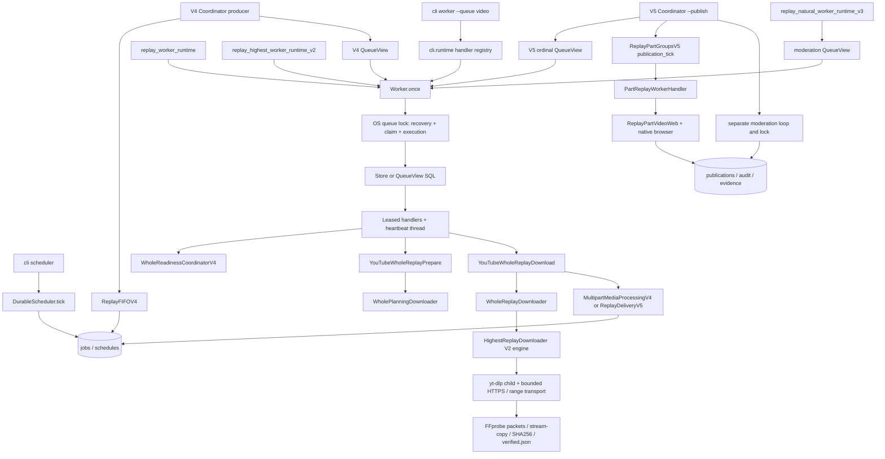

# Video Worker / Download Worker 2.0 — Phase 0 audit

Date: 2026-11-10. Source baseline: `1272f86`. This report precedes implementation.
Evidence: local source inspection; AST boundary index over 494 files / 2,044
functions; read-only SSH inspection of Docker and SQLite on the production host.
The detailed call-site and live schema inventory is in
[video-worker-audit-index.md](video-worker-audit-index.md).
Private operational evidence remains outside this repository (no credentials,
raw job payloads or browser profiles are copied into these documents).

## 1. Actual deployment versus repository defaults

The public compose file defines api, scheduler, tweet-worker, video-worker and
system-worker using the shared runtime. Production does NOT use this file alone:

| Component | Observed command / status | Implication |
|---|---|---|
| api | cli api; healthy, running | Do not recreate during this migration |
| scheduler | cli scheduler; running; service.py override | Keep actual discovery policy |
| tweet-worker | cli worker; running; independent image/overrides | Do not replace its deployment |
| system-worker | cli worker; running; replay-monitor image | Preserve backups/maintenance |
| video-worker | replay_parts_worker_runtime_v5 --publish; exited; restart=no | Existing V5 combines acquisition and publication |
| subtitle-runner | /app/runner.py; exited; restart=always | Separate historical replay polling process; not this new worker |

Production video image is `sha256:360c6f546e26d54d6ce58efbe6b7de6006e361caaf188b6cc836d868d981969c`.
Its compose provenance includes `/tmp/video-worker-replay-fix.yaml`. Source
overrides include download adapters, policy/processing modules, native browser
controls, a browser patch mounted from a backup directory, launch authorization,
retention qualification and a read-only YouTube key. These cannot be discarded by
running a blanket `docker compose up` from this checkout.

198 effective Python/SQL/JS source files were compared after newline normalization;
25 differ from the public checkout, including FIFO, CLI, YouTube monitor, legacy
download, budgeting, backup and tweet modules. Store, Worker, V4 runtime and V5
runtime match after normalization. Raw byte differences alone would have
incorrectly classified Windows CRLF as source drift.

Production SQLite uses WAL. Video pipeline flag is unpaused, but the video
container is stopped. Free disk at audit: about 51 GiB of 89 GiB. Stopping the
container is distinct from pausing its database pipeline. New acquisition must
not accidentally start old pending discovery/publication jobs.

## 2. Verified call graph

The arrows above follow imports, handler construction and calls, not names alone.
Creation also occurs in API/manual review routes, video pipelines, readiness
coordinators, FIFO `_enqueue`/plan/download/refresh ticks, V5 group/child creation,
moderation schedules, and operational scripts (full index linked above).
`Store.enqueue` deduplicates platform/source/type/policy; several coordinators
use explicit INSERTs in their own guarded transactions. Do not replace them with
a new queue or erase their unique identity semantics.

## 3. Worker / adapter compatibility matrix

| Entry | Handler family | Adapter / reason to preserve |
|---|---|---|
| cli.runtime | discovery, video_process, youtube_download | original YouTubeDownload / ytdlp_replay; historical tasks and reviews |
| replay_worker_runtime | legacy replay publish and download | short-video/native/browser evidence compatibility |
| replay_highest_worker_runtime_v2 | highest prepare/download/publish | ytdlp_highest_v2; also the shared V4 transport engine |
| replay_natural_worker_runtime_v3 | natural plan/readiness/download + lookups | natural adapters + moderation_common; historical receipt validation |
| replay_multipart_worker_runtime_v4 | plan/download/refresh/readiness | whole-plan/whole/readiness adapters; acquisition only |
| replay_parts_worker_runtime_v5 | V4 plus p01..p32 publishing | V5 parts and browser contract; existing production entry |
| replay_part_moderation_v5 | lookup-only child jobs | result reconciliation, cannot submit |
| replay_multipart_private_v4 | one explicit private probe job | historical upload_pending/result semantics; maintenance scripts |

The term Download Worker 2.0 is a deployment boundary, not a replacement for
versioned payloads. V4 currently also prepares validated delivery parts after
download. Removing that behavior would break downstream consumers. Preserve it
as local delivery preparation; no Bilibili submission handler is registered.
V5's legacy combined mode must remain compatible; a new explicit publication-only
mode is preferable if V5 is later run alongside independent acquisition.

## 4. Database and state dependencies

Shared columns: job_id, platform/source_id/type/queue/policy, payload/result,
stage, attempts, lease_owner/until, next_run, error_code, external_publish_id and
created/updated timestamps. Tables and all live field definitions appear in the
schema appendix. Important groups:

- Core: jobs, publications, pipelines, heartbeats, events/event_dedup, audit,
  schedules, subscriptions/deliveries; API accounting and source tombstones.
- Discovery: youtube_videos, source cursors/polls/receipts.
- FIFO: replay_fifo_v4, dispatches, capacity, resource_holds, retired_jobs,
  source revisions; authoritative metadata/source binding is retained.
- Readiness/custody: youtube_readiness_waits_v4, youtube_track_custody_v4.
- Publication: replay_multipart_parts_v4, replay_part_groups/children_v5,
  delivery_outputs, lookup_schedule/attempts; signed video reviews and retention
  authorizations; bilibili_uploads/parts.

Base migrations live under scheduler/migrations; some version-specific tables
are initialized by their services. No schema change is needed for type filtering.
Live history contains completed V2 publication, 14 completed V4 downloads,
V5 part publications and lookup jobs, retired/superseded job types and source
revision history. Five readiness jobs are awaiting review. Generic pending work
also exists. It is not safe to migrate by resetting these records.

| State | Entered / left by | Automatic behavior |
|---|---|---|
| pending | enqueue -> Worker claim | Claim only owned types with attempts remaining |
| processing | transactional claim; heartbeat; checkpoints | Lease and OS lock are independent; finish/recover owns transition |
| retry_scheduled | bounded handler failure or interrupted processing -> claim | next_run and max_attempts gate; resource waits keep original semantics |
| awaiting_review | validation/identity/resource-policy refusal | Explicit existing review/reconciliation required; never ordinary claim |
| publish_unknown | lost result/reservation/recovery | Lookup only, never blind retry |
| completed | validated handler outcome/result reconciliation | Terminal; preserve publication identity |
| failed | exhausted attempts or nonretryable fault | Explicit scoped maintenance only |
| auth_expired | recognized session/auth failures | Requires restored authorization; no automatic account switching |
| awaiting_moderation | submitted, platform pending | Bounded lookup to completed/rejected/hold |
| upload_pending | private/upload workflow checkpoint | Existing specialized handlers only |

The last two are real existing states beyond the requested minimum. They must
not be normalized away. Parent/child projections and review holds remain distinct
from platform publication success. Existing authorized automatic publication
policy and genuine manual review fields are preserved, not replaced with fake
human approval.

## 5. Files, processes, locks and recovery

V4 workspace: media/<UUID>/youtube-whole-v4[-plan]. UUID, absolute path,
symlink/permission and bounded file checks already exist. It stores ticket,
download-result, progress, selected stream partials, original.mp4, verified.json,
extractor observations and attempt failure evidence. Other versions retain their
own directories. `atomic_json` and directory fsync protect evidence commits.
Highest engine reuses a verified receipt only after binding/size/SHA256 checks;
finalization probes streams, validates quality, compares packet coverage and
stream-copies. Delivery validation and custody authorize raw-track release.

Child subprocesses have bounded timeouts, periodic binding/disk checks and process
group termination. Network adapters restrict destinations/headers, budgets and
platform errors. Existing retries are disabled inside yt-dlp, with durable worker
attempts controlling retry. Partial files must be retained across process failure.
No verification receipt is evidence of human approval.

`Worker.once` holds `data/locks/<queue>` around recovery/claim/execution. Heavy
FFmpeg/browser work also uses `data/locks/heavy`; producer and moderation have
separate locks. The separate moderation lock is intentional for lookup-only work,
not permission for another simultaneous download. Locks come from the vendored
observer implementation. V4 producer exits the process on fatal thread failure,
preventing a download heartbeat from hiding a dead producer.

## 6. Risks and controlled resolutions

| Severity | Finding | Resolution / boundary |
|---|---|---|
| High | Store claim/recover has no type whitelist; generic worker can consume V4 and recover unrelated work | Optional SQL whitelist, Worker always supplies its handlers; intersect every QueueView |
| High | V2/V3 main QueueView excludes only lookup type | Add positive handler filter while preserving historical policy guards |
| High | V4, V5, private and moderation stores have incompatible claim/recover signatures | Update all in-tree implementations together; regression tests |
| High | all_processing relies on caller discipline | Require lock ownership proof for forced recovery; preserve ordinary expired-lease recovery |
| High | heartbeat failures return/raise without coordinating worker completion | Detect renewal loss, prevent completion, adapters continue lease checks; test interruption |
| High | production image/overrides differ from repo | Separate isolated test project; never blanket replace running services |
| High | V5 combined runtime overlaps new acquisition types | Preserve legacy default; explicit separate mode/config before co-deployment |
| High | .gitmodules exists but gitlinks/vendor/compositor are absent in public tree | Restore exact upstream-lock commits, verify hashes, do not invent replacements |
| Medium | state transitions duplicated in QueueViews | Share bounded SQL scope helper first, preserve specialized recover outcomes |
| Medium | generic OSError/OperationalError handling can conceal errors | Distinguish expected lock contention and DB busy from permanent errors; stable diagnostics |
| Medium | Python/Node packages pinned, Ubuntu base/APT versions not immutable | Record actual image/dependency versions; no startup upgrade; do not claim reproducible base |
| Medium | raw hash validation and ffprobe may be long | Check lease while verifying; retain capacity limits and timeout tests |
| Medium | external ops and dynamic imports rely on old modules | No deletions proved safe in this audit |

## 7. Refactor sequence and acceptance boundaries

1. Add validated SQL whitelist helper and update Store/Worker/all QueueViews;
   test empty, malicious, overlapping and concurrent scopes, recovery/fencing.
2. Add profile-gated acquisition service with no ports, readonly profile, secret,
   hardening, limits and separate main/producer readiness. Existing services stay.
3. Test and repair only demonstrated receipt/lease/error/space gaps; reuse adapters.
4. Run existing tests plus SQLite/process/Docker fault tests against temporary
   data. Real YouTube test is separate and must be labeled accurately. No test posts.
5. Delete nothing unless production, scripts, tests, dynamic imports and history
   all demonstrate no dependency. Keeping an old version is a valid outcome.
6. Capture immutable previous deployment, consistency snapshot and rollback;
   deploy only targeted service after compatibility and authorization gates.

Overall risk: HIGH for replacing production wholesale; MODERATE for additive,
profile-disabled worker plus SQL scope changes with isolated acceptance. The
audit identifies no safely deletable historical adapter. Existing release hashes
and retention qualifications must not be silently rewritten to accept new code.

Phase 0 checks: read-only live inventory completed; source/SQL call index generated;
no production service/data changed. Baseline tests cannot yet import the lock
module because the public checkout lacks upstream gitlinks. This is an observed
packaging failure, not a tested runtime success.
