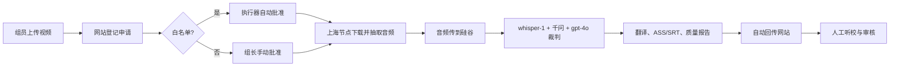

# 灯塔字幕札记 · 字幕协作开源版

**当前版本：v0.3.0-beta.1（全自动内测版）**。原名“字幕协作台”，仓库地址保持不变。查看 [本次更新与升级](docs/版本更新.md) 和 [自定义域名与 HTTPS](docs/域名与证书.md)。

把一个视频交给字幕组，留下每次交付、审核和贡献的记录。

这里公开了这个项目自己编写的网站前端、PostgreSQL 后端、自托管字幕执行器、QQ 机器人接口、部署脚本、测试和技术记录。你可以学习它、改造它，也可以为自己的字幕组搭建一套。

**第一次接触这些工具？从 [从零搭建](docs/从零搭建.md) 开始。只想使用已经搭好的网站？看 [组员与组长使用手册](docs/使用手册.md)。**

## 它已经能做什么

- 成员注册与审批；项目负责人、审核员和普通成员分别授权。
- 项目、任务、认领、交付版本、审核、贡献履历和积分流水。
- 按任务类型交付字幕、视频或封面；私有文件下载时校验大小与 SHA-256。
- 最长 **20 分钟 / 1 GiB** 的视频申请；白名单成员自动批准，非白名单仍由组长手动批准。
- 每人每天 2 条 / 40 分钟、全局每天 6 条 / 120 分钟的限额，超限申请留在待审批，不会重复扣费。
- 上海节点从 CloudBase 同地域下载原视频，只抽取音频（20 分钟约 10MB）后传到硅谷；本地素材立即清理。
- 硅谷节点用 whisper-1（时间轴）+ 千问（第二意见）+ gpt-4o-transcribe（分歧裁判）做三方识别，再翻译、生成 ASS/SRT 和报告并自动回传。
- 开始与完成通知私聊申请人和组长（机器人调用 `st_qq_job_feed`）。
- 组长网页白名单面板：启用成员、设置每人/全局每日限额。
- 任务待办、截止时间、反馈摘要、找回密码、回收站、受控硬删除、7 天原视频清理。
- 云执行身份的创建、撤销、备注修改和已撤销身份的删除/恢复。

**这是全自动工作流。** 白名单成员的申请由执行器自动批准、自动领取、自动识别和回传；不需要人登录 ChatGPT，也不需要粘贴执行指令。上海与硅谷分工的原因是：CloudBase 在上海（下载快），而 OpenAI 只能从硅谷访问。20 分钟视频从提交到交付通常 3–6 分钟。

## 先体验，再决定搭建

1. 点击 GitHub 页面上的 **Code → Download ZIP**，解压。
2. 打开 `docs/使用手册.html`，不登录、不安装软件即可阅读日常使用说明。
3. 要搭建自己的平台，按 [从零搭建](docs/从零搭建.md) 准备账户，双击 `开始配置.cmd`，生成属于你自己的部署文件。
4. 按教程把网站、数据库、上海节点、硅谷执行器和机器人分别接好。每个阶段都有验收方法，可以分阶段完成。

下载源码不等于获得云服务额度。CloudBase、服务器和模型服务各有自己的费用、权限及可用地区，开通前以各服务页面为准。本仓库的配置工具只生成本地文件，不自动购买、升级或调用收费模型。

## 仓库导航

| 目录 | 装着什么 | 谁通常需要看 |
| --- | --- | --- |
| `site/` | 当前网站的完整静态页面和脚本 | 搭建者、前端开发者 |
| `database/` | 表、权限、业务函数、迁移清单 | 搭建者、后端开发者 |
| `worker/` | 识别、翻译、检查、交付与请求账本 | 执行器配置者 |
| `runner/` | 上海轮询/拉取、硅谷 ingest、systemd 示例 | 服务器管理员 |
| `bot/plugins/` | QQ 身份绑定、通知、指令私聊和清理程序 | 机器人管理员 |
| `ops/` | Docker 部署与运维工具 | 服务器管理员 |
| `tools/` | 本地部署生成、检查和发布辅助工具 | 搭建者、维护者 |
| `tests/` | 使用虚构账号和模拟网络的回归测试 | 开发者 |
| `experiments/` | 初版工作器、未启用的调度器、历史诊断 | 想研究过程的人 |
| `docs/` | 中文教程、架构、安全、费用和排错 | 所有人 |

## 接下来读什么

- [自动化架构](docs/AUTOMATION.md)：上海拉取、硅谷 ingest、三方识别、限额与清理。
- [从零搭建](docs/从零搭建.md)：从账号、下载到第一次完整验收。
- [使用手册](docs/使用手册.md)：组员、组长、PC、安卓端的日常操作。
- [请助手协助搭建](docs/请助手协助搭建.md)：不会使用终端时如何协作，以及出错时提供哪些信息。
- [系统如何工作](docs/架构与数据.md)：权限矩阵、数据结构与消息流。
- [维护与故障排查](docs/维护与排错.md)：费用、备份、恢复、密钥与异常处理。
- [开发与测试](docs/开发与测试.md)：运行检查、贡献代码、已验证范围。
- [开源范围与历史](docs/开源范围.md)：哪些实现已公开，哪些材料不属于可分发源码。
- [第三方声明](THIRD_PARTY_NOTICES.md)、[安全报告方式](SECURITY.md)、[贡献指南](CONTRIBUTING.md)。

## 许可与当前边界

本项目自己的代码和文档使用 **AGPL-3.0-only**，见 [LICENSE](LICENSE)。允许使用、修改和分发；修改后通过网络提供服务时，需按许可证向使用者提供相应源码。第三方代码保留各自许可。

这是从实际小型字幕组项目整理的社区内测版本。源码与离线测试已经整理，**没有替你在一个新云账户中完成部署验收**；请先使用测试环境和自己有权处理的短视频。实际限制和本次验证记录见 [验证状态](docs/验证状态.md)。

Codex Cloud 已从正式流程移除，改为自托管执行器。原始视频、成员资料、密码、API Key、聊天原文、生产备份与通知账本均不包含在仓库中。开源的是实现与方法，每个字幕组使用自己的账户和资料。
